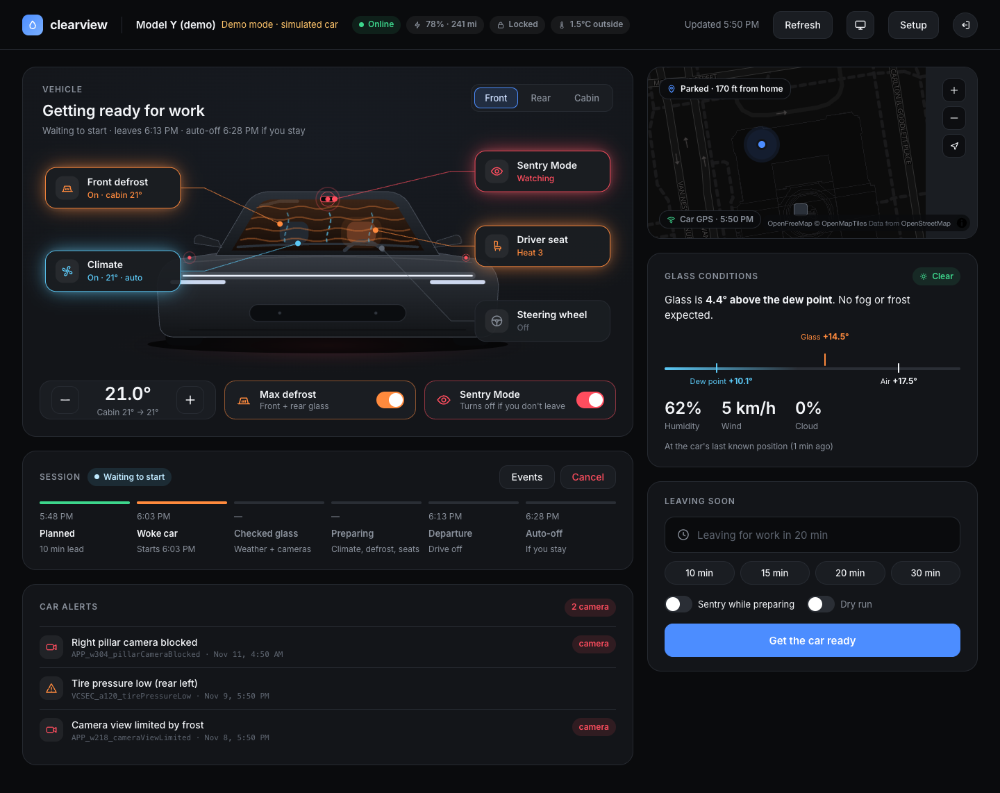
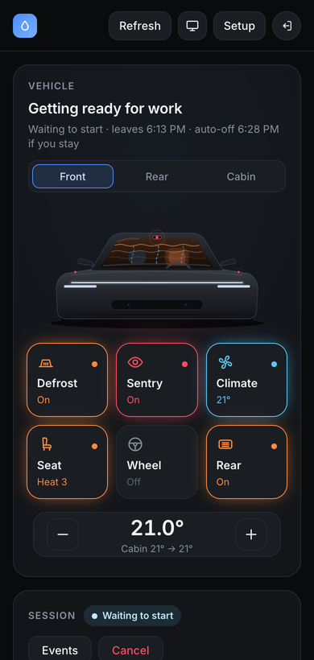
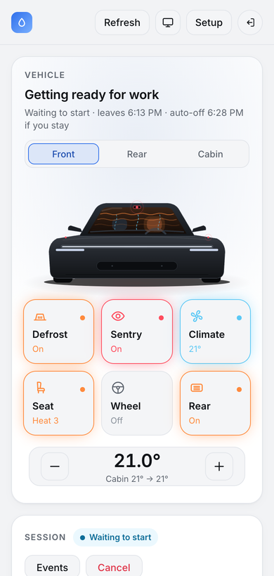

# tesla-clearview

Tell it when you're leaving. It gets your Tesla's glass clear and the cabin ready.
Then it shuts everything off if you don't go.

<picture>
  <source media="(prefers-color-scheme: dark)" srcset="docs/images/dashboard-dark.png">
  <source media="(prefers-color-scheme: light)" srcset="docs/images/dashboard-light.png">
  
</picture>

<sub>Screenshot from demo mode (`CLEARVIEW_DEMO=true`): the car is simulated, the weather and map are live.</sub>

```
$ clearview say "leaving for work in 10 min"
```

- **Fog and frost check:** estimates the glass temperature and compares it with the dew point, using Open-Meteo weather at the car. A Claude vision check of the latest Sentry/Dashcam frames is added when clips are available.
- **Climate actions:** Max Defrost when fog or frost is likely. That covers the front and rear defrosters plus airflow to the windscreen and demist vents. Otherwise normal climate. Seat and steering-wheel heat when it's cold.
- **Camera cleaning alerts:** a push notification for each camera with how much of the view is blocked (mud, snow, ice, water). It includes the snapshot and the car's own "camera blocked" alerts.
- **Battery-safe:** nothing polls the car. clearview only contacts it after you trigger it, wakes it once, and starts climate at the right lead time. Climate turns off `STOP_GRACE_MIN` after your departure time if the car hasn't moved. clearview won't precondition below `MIN_BATTERY_PCT`.
- **Dashboard:** a web app on your home server where the car itself is the control panel (see below). Light and dark mode.

## Dashboard

`clearview serve` runs the dashboard and the HTTP API on your home server.

<table>
  <tr>
    <td width="50%"></td>
    <td width="50%"></td>
  </tr>
</table>

- **The car is the control panel.** Buttons point at the part of the car they control: windscreen (front defrost), camera (Sentry), vents (climate), seats and steering wheel. The **Rear** tab covers rear defrost, and **Cabin** has both seats. On a phone they become a grid of tiles.
- **The drawing shows what the car reports.** Heat lines drift up the glass, rings pulse around the cameras, air flows from the vents, and seats glow. While a command is on its way, the button shows *Waking car…* and a blue sweep runs across the light bar. Nothing shows as on until the car confirms it.
- **Map:** your car, home and phone on [MapLibre](https://maplibre.org) with [OpenFreeMap](https://openfreemap.org) tiles: free, no API key, no usage limits.
- **Glass conditions:** glass temperature against dew point and air temperature, the frost/fog risk, and how many minutes defrost needs.
- **Leaving soon:** "Leaving for work in 20 min", with quick times, optional Sentry while preparing, and a dry run.
- **Session timeline:** Planned → Woke car → Checked glass → Defrosting → Departure → Auto-off, with the event log and Cancel.
- **Car alerts:** recent alerts from the car, with camera warnings flagged.
- **Setup checklist:** every one-time step, checked live (public key, callback page, Tesla login, virtual key, signing proxy).
- **Light and dark mode:** follows your system by default. The top-bar button cycles System → Light → Dark and remembers your choice in that browser.

**Try it without the car:**

```bash
CLEARVIEW_DEMO=true uv run clearview serve    # simulated car; never touches the real one
```

Open <http://localhost:8787> and sign in with `CLEARVIEW_API_TOKEN`.

## How it fits together

```
 phone / laptop ──► home server: clearview serve ──► Tesla Fleet API
                     │  dashboard + API             (reads)
                     └─► signing proxy (Docker) ───► Tesla Fleet API
                                                     (signed commands)

 GitHub Pages (<user>.github.io): public key + login callback page only
```

- **Everything runs on your home server.** Nothing at home is exposed to the internet. Use [Tailscale](https://tailscale.com) to reach it from your phone away from home.
- **Tesla needs a public HTTPS domain** for two static files: your public key, and the OAuth redirect page. The redirect page forwards your browser back to the home server, and only to private addresses (localhost, LAN, `*.local`, Tailscale). See [site/](site/).

## What Tesla's API can and can't do

| Want | Fleet API? | How clearview handles it |
|---|---|---|
| Live camera / Sentry view | **No.** Live Camera (Premium Connectivity) only works in Tesla's own app. The Fleet API has no camera or video endpoint. | Reads the newest clips from the car's **USB drive** (`TESLACAM_PATH`). One way is a Raspberry Pi acting as the USB drive and syncing over Wi-Fi ([TeslaUSB](https://github.com/marcone/teslausb)). Falls back to the weather model when there are no recent clips. |
| Front + rear defrost | Yes: `set_preconditioning_max` | Used when fog or frost risk is high. The dashboard's Rear defrost button uses it too, because the API has no command for rear defrost alone. |
| Point vents at side windows | **No**: vent direction can't be set remotely | Max Defrost already sends air to the windscreen and side demist vents. A/C on dries the cabin air. |
| Camera-blocked warnings | Partly: `recent_alerts` | Matched for camera-related alerts; shown on the dashboard |
| Sentry Mode on/off | Yes: `set_sentry_mode` | Dashboard button. `SENTRY_ON_DEPART` (or "Sentry while preparing") turns it on during a departure session and back off if you don't leave |
| Climate, temperature, seat/wheel heat | Yes | Used |

The front camera sits behind the windscreen, so fog there shows up in its frames. Tesla heats that small patch of glass, though, so the weather model still matters. No camera sees the rear window.

## Setup

See **[docs/SETUP.md](docs/SETUP.md)** for the one-time Tesla setup:
- generate the key pair
- publish the Pages site
- create the developer app
- register your domain and log in
- pair the virtual key
- run the signing proxy

```bash
uv sync
cp .env.example .env          # fill in
./scripts/gen_keys.sh
./scripts/publish_site.sh ~/path/to/<user>.github.io
docker compose up -d          # command signing proxy
uv run clearview serve        # then open the dashboard and follow the Setup checklist
```

The main settings in `.env`:

| Setting | What it does |
|---|---|
| `TESLA_CLIENT_ID`, `TESLA_CLIENT_SECRET` | Your app from developer.tesla.com |
| `TESLA_DOMAIN`, `TESLA_REDIRECT_URI` | Your Pages site, e.g. `you.github.io` and `https://you.github.io/callback/` |
| `CLEARVIEW_API_TOKEN` | Dashboard password and API token (`openssl rand -hex 24`) |
| `API_HOST` | `0.0.0.0` to open the dashboard from other devices on your network |
| `CLEARVIEW_PUBLIC_URL` | How your browser reaches the server, if not the address you open it on (e.g. a Tailscale `https://….ts.net`) |
| `CLEARVIEW_DEMO` | `true` for the simulated car |
| `SENTRY_ON_DEPART` | Turn Sentry on during departure sessions |
| `STOP_GRACE_MIN`, `MIN_BATTERY_PCT` | Auto-off delay after departure; minimum battery for preconditioning |
| `HOME_LAT`, `HOME_LON` | Optional fallback location. Normally your phone's location or the car's last known position is used |

## Usage

```bash
clearview say "leaving for the gym at 6:30am"
clearview depart work --in 15
clearview analyze /Volumes/TESLADRIVE/TeslaCam --notify   # camera check only, no car connection
clearview status --wake
clearview serve                                            # dashboard + HTTP API for Siri / Shortcuts
```

### From your phone (Siri / iOS Shortcut)

Run `clearview serve` on an always-on machine (Mac mini, Pi, NAS) and reach it over Tailscale rather than opening a port. Then create a Shortcut:

1. *Dictate Text* → "leaving for work in 10 minutes"
2. *Get Current Location*
3. *Get Contents of URL* → `POST http://<host>:8787/depart`
   - header: `Authorization: Bearer <CLEARVIEW_API_TOKEN>`
   - JSON body: `{"text": "<Dictated Text>", "lat": <Latitude>, "lon": <Longitude>}`

Your phone's location lets clearview plan for fog or frost wherever the car is (home, a hotel, the office) before it wakes the car. Without it, clearview uses the car's last known position. After the car wakes, its own GPS decides.

Then say "Hey Siri, *Car ready*". Notifications arrive in the [ntfy](https://ntfy.sh) app (subscribe to your `NTFY_TOPIC`). `DELETE /sessions/{id}` cancels a session and turns climate off.

## Costs

- **Tesla Fleet API** is pay-per-use. Personal accounts currently get a monthly credit that comfortably covers this usage. A session is about 1 wake, 2 data reads, 1 alerts read and 2-6 commands. Each dashboard button press is a wake and a command, plus a read to confirm.
- **Claude vision** is one request per session with up to 6 frames, at low effort. Set `ANTHROPIC_API_KEY`.
- **Map and weather** are free: OpenFreeMap and Open-Meteo need no key.

## Development

```bash
uv run pytest
CLEARVIEW_DEMO=true uv run clearview serve   # work on the dashboard against the simulated car
```

The dashboard is a single file, [src/clearview/web/index.html](src/clearview/web/index.html), with no build step.
